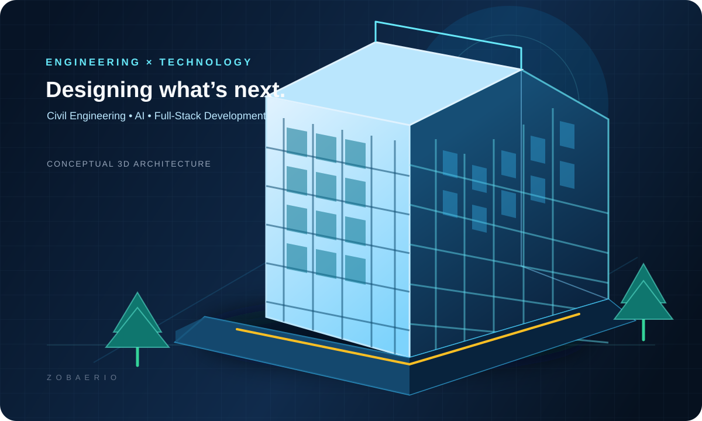

 

# MD ZOBAER HASAN

### Civil Engineering Student · AI & Full-Stack Developer

  
  
  

  
  
  

---

## About

I'm **MD Zobaer Hasan**, a Civil Engineering student from Bangladesh with a strong interest in software development and artificial intelligence.

I enjoy turning ideas into practical digital products — from AI-powered web applications and automation workflows to engineering tools for planning, drafting, and construction estimation.

My long-term goal is to bring **Civil Engineering, 3D technology, and Artificial Intelligence** closer together through useful, accessible software.

- 🎓 Studying for a Diploma in Civil Engineering
- 🤖 Building AI-powered applications and agent workflows
- 🌐 Developing modern web experiences and full-stack products
- 🏗 Exploring CAD, 2D/3D building design, BOQ, and estimation systems
- 🌱 Continuously learning, experimenting, and improving

## What I'm Building

<table>
<tr>
<td width="50%" valign="top">

### 🏗️ CivilOS AI

An AI-focused civil engineering platform concept bringing together design, drafting, quantity surveying, estimation, and engineering workflows.

[Explore the repository →](https://github.com/zobaerio/CivilOS-AI)

</td>
<td width="50%" valign="top">

### 🤖 ORVIX AI

An AI assistant project focused on natural interaction, useful agent workflows, and a cross-device assistant experience.

[Explore the repository →](https://github.com/zobaerio/orvixai)

</td>
</tr>
</table>

## Core Interests

| 🏗️ Civil & Design | 🤖 AI & Automation | 🌐 Software |
|:---:|:---:|:---:|
| Civil Engineering | Generative AI | Full-Stack Web |
| AutoCAD & Drafting | AI Agents | React & Next.js |
| 2D / 3D Concepts | API Integration | TypeScript |
| BOQ & Estimation | Workflow Automation | Firebase & Supabase |
| Building Planning | Prompt Engineering | Git & GitHub |

## Technology Stack

  

**Currently exploring:** AI agents · OpenAI and Gemini APIs · 3D web experiences · CAD workflows · Cloud deployment

## GitHub Statistics

 

 

## Beyond the Code

I like exploring the intersection of the built environment and digital technology: how better software can make engineering workflows clearer, faster, and more accessible.

> **“Design with purpose. Engineer with precision. Build with imagination.”**

## Let's Connect

  

**Thanks for visiting my profile!** If something here interests you, feel free to explore my repositories or say hello.

